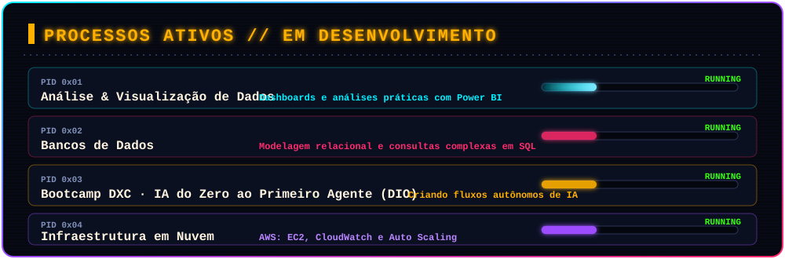
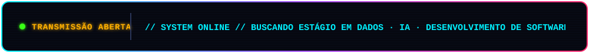

  

## ⟦ SOBRE MIM ⟧

> 

Estudante de **Engenharia de Software** focado em **Análise de Dados, Bancos de Dados e Inteligência Artificial**. Meu objetivo é consolidar fundamentos sólidos de computação para estruturar soluções eficientes e orientadas a dados.

- 🎓 **Educação:** Cursando Bacharelado em Engenharia de Software na **UNICID** (Universidade Cidade de São Paulo).
- 🎯 **Foco Atual:** Modelagem de Banco de Dados, Análise Preditiva em Python e arquitetura de soluções em nuvem.
- 💡 **Filosofia:** Aprendizado prático baseado em fundamentos — cada conceito estudado vira um projeto documentado.
- 🛠️ **Objetivo Profissional:** Buscando oportunidades de **estágio** na área de Dados, IA ou Desenvolvimento de Software.

## ⟦IDIOMAS ⟧

## ⟦ MEU PORTFÓLIO ⟧

<h3>Exercícios, projetos acadêmicos e atividades práticas:</h3>
<li> atividade de criptografia:</li>

🔗 **[Acessar Repositório de Atividades & Portfólio](https://github.com/Felipetc-dev/Felipetc-dev/tree/main)**

## ⟦ MINHAS STACKS ⟧

<h3>⚔️ Linguagens & Web</h3>

<h3>📚 Dados & Banco de Dados</h3>

<h3>🔮 Inteligência Artificial & Nuvem</h3>

<h3>🧰 Ferramentas de Trabalho</h3>

## ⟦ APRENDIZADO EM DESENVOLVIMENTO ⟧

## ⟦ CANAL DE COMUNICAÇÃO ⟧

 

